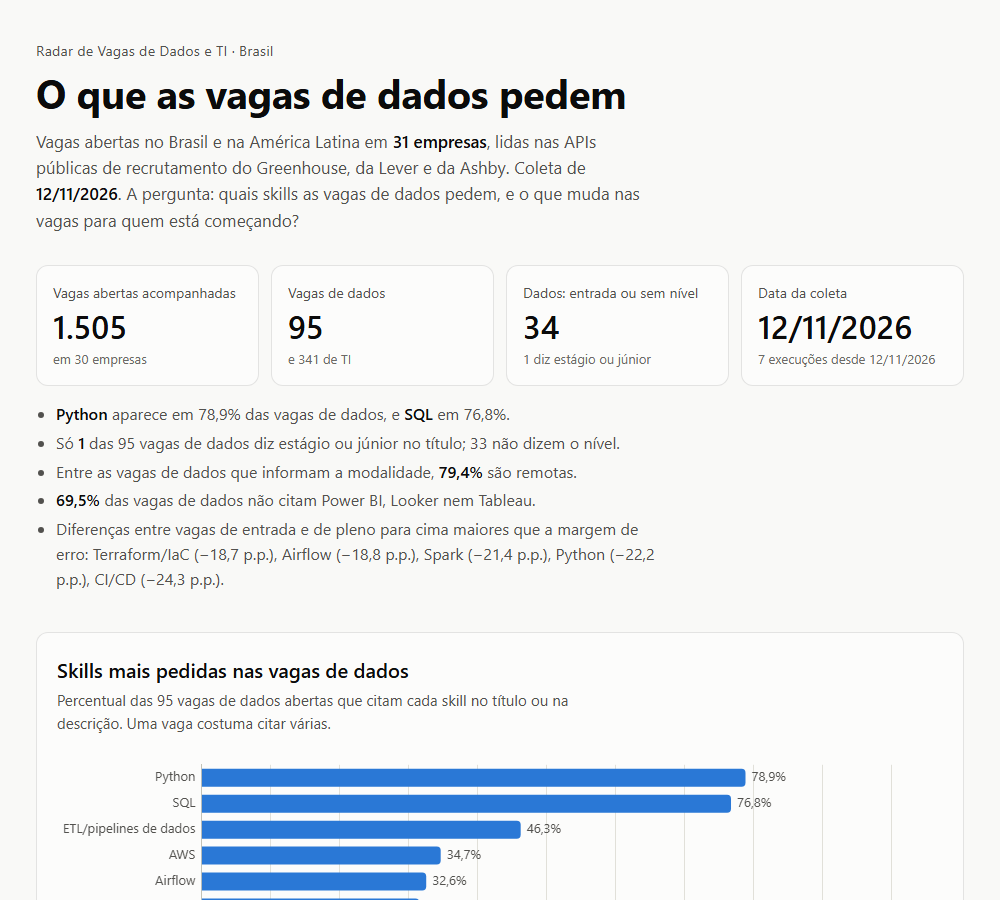
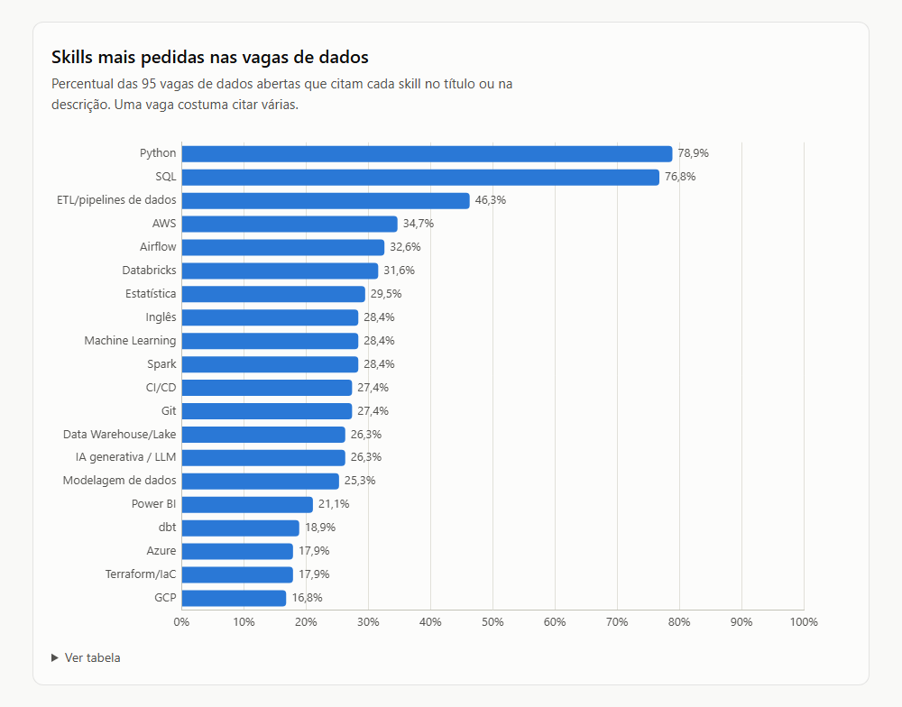
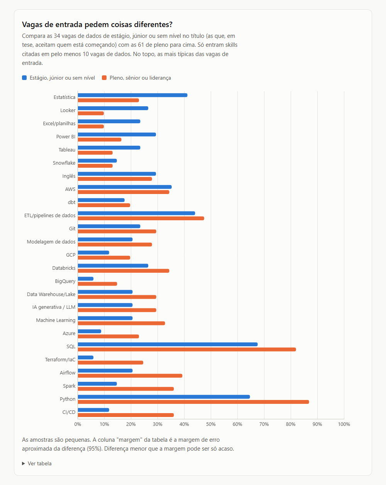

# Radar de Vagas de Dados e TI

Toda semana, este projeto coleta as vagas de dados e TI de 31 empresas pelas APIs públicas de recrutamento, guarda os dados num banco SQLite e publica uma página com os resultados. As análises ficam todas num arquivo SQL.



## English summary

Portfolio project: which skills do data job postings in Brazil ask for, and what changes in postings open to beginners? A Python collector reads the public job-board APIs of Greenhouse, Lever and Ashby for 31 companies (Terms of Service and `robots.txt` checked for each source), keeps only Brazil and Latin America postings, and stores metadata, extracted skills, a hash of the description and the link in SQLite. Full descriptions are never stored. The upsert is idempotent (two consecutive real runs leave the database identical), all analyses live in one SQL file, and a static page with Chart.js is regenerated weekly by GitHub Actions (latest automated run on 16/11/2026: 1,478 active Brazil/LatAm roles, 91 in data — Python 78.0%, SQL 76.9%). Live dashboard: https://balchuna.github.io/radar-vagas-dados/ · Stack: Python, requests, SQLite, SQL, Chart.js, pytest (101 tests, CI passing).

## A pergunta

Quais skills as vagas de dados pedem, e o que muda nas vagas para quem está começando?

No começo, a ideia era olhar só as vagas júnior. Mas quase nenhuma vaga de dados dizia "júnior" ou "estágio" no título (1 de 95). Por isso o projeto analisa as vagas de dados de todos os níveis e compara dois grupos:

- entrada ou sem nível: estágio, júnior ou título sem nível (34 vagas);
- pleno para cima: pleno, sênior ou liderança (61 vagas).

Um título sem nível não garante que a vaga aceite iniciantes. É uma aproximação, e ela aparece de novo nas limitações.

## Os dados

As vagas vêm das APIs públicas de quadros de vagas do Greenhouse (22 empresas), da Lever (6) e da Ashby (3). São os mesmos dados que aparecem na página "Trabalhe conosco" de cada empresa, e as APIs não pedem login nem chave.

Antes de usar cada fonte, li os termos de uso e o `robots.txt`. O registro, com os links, está em [docs/FONTES.md](docs/FONTES.md). A Gupy ficou de fora porque os termos proíbem agregar o conteúdo da plataforma, e o LinkedIn porque proíbe coleta automatizada.

As 31 empresas entraram porque o quadro de vagas respondeu e tinha pelo menos uma vaga no Brasil ou na América Latina na sondagem de 12/11/2026. A lista está em [config/empresas.yaml](config/empresas.yaml). Não é uma amostra do mercado.

De cada vaga, o banco guarda título, empresa, local, modalidade, nível, área, data de publicação, link, as skills encontradas e um hash SHA-256 da descrição. O texto da descrição não é guardado.

O programa se identifica como projeto de portfólio, faz no máximo 1 requisição por segundo em cada site e para de chamar a fonte se receber 403 ou 429.

## O caminho dos dados

| Etapa | Comando | O que faz |
|---|---|---|
| 1. Coleta | `python scripts/coletar.py` | Chama a API de cada empresa, descarta vagas fora do Brasil e da América Latina e "banco de talentos", lê título e descrição na memória e grava em `radar.db` com UPSERT |
| 2. Normalização | (módulos `src/radar/normalizar.py` e `src/radar/skills.py`) | Área e nível pelo título; modalidade pela fonte, pelo local ou pela descrição; 65 skills por um dicionário versionado ([config/skills.yaml](config/skills.yaml)) |
| 3. Conferência | `python scripts/conferir_idempotencia.py` | Roda duas coletas reais seguidas e compara o banco depois de cada uma |
| 4. Análises | [sql/analises.sql](sql/analises.sql) | Uma consulta com nome por pergunta, rodada com o banco aberto só para leitura |
| 5. Relatório | `python scripts/relatorio.py` | Grava [docs/index.html](docs/index.html) e [docs/dados/agregados.json](docs/dados/agregados.json) e imprime os números |
| 6. Toda semana | [.github/workflows/coleta.yml](.github/workflows/coleta.yml) | Coleta toda segunda-feira, gera a página e commita só ela e o JSON |

A explicação sem jargão está em [docs/COMO-FUNCIONA.md](docs/COMO-FUNCIONA.md). As escolhas, com o motivo de cada uma, estão em [docs/DECISOES.md](docs/DECISOES.md).

## Resultados

Os números abaixo são da coleta de referência de 12/11/2026 (última execução às 19:31 UTC), feita no meu computador. Salvo indicação, cada um sai de `python scripts/relatorio.py --db radar.db`, e o nome entre parênteses é a consulta de [sql/analises.sql](sql/analises.sql). A página [docs/index.html](docs/index.html) e o [docs/dados/agregados.json](docs/dados/agregados.json) são refeitos toda semana pelo GitHub Actions, numa série própria que começou em 14/11/2026 — na coleta agendada de **16/11/2026**, foram **1.478 vagas ativas** no Brasil/LatAm e **91 de dados** (Python 78,0% e SQL 76,9%), atualizadas automaticamente em https://balchuna.github.io/radar-vagas-dados/.

- As 31 empresas responderam. Ficaram 1.505 vagas abertas no Brasil e na América Latina, em 30 empresas: 95 de dados, 341 de TI e 1.069 de outras áreas (`panorama`, `area_por_nivel`). Por fonte, foram 1.350 no Greenhouse, 145 na Lever e 10 na Ashby (`python scripts/resumo.py`).
- Nas vagas de dados, as skills mais pedidas são Python, em 78,9% (75 vagas), SQL, em 76,8% (73), ETL/pipelines de dados, em 46,3%, AWS, em 34,7%, e Airflow, em 32,6% (`top_skills_dados`). Python e SQL aparecem juntos em 63 vagas, 66,3% (`pares_skills_dados`).
- Das 95 vagas de dados, só 1 diz estágio ou júnior no título (1 estágio e nenhuma júnior), 33 não dizem o nível e 61 são de pleno para cima: 10 pleno, 47 sênior e 4 liderança (`area_por_nivel`). Somando dados e TI, são 14 vagas de estágio ou júnior (`vagas_entrada`).
- Comparando as 34 vagas de entrada ou sem nível com as 61 de pleno para cima, cinco skills aparecem bem menos nas de entrada, com diferença maior que a margem de erro de 95% (`skills_por_nivel_dados`, margem calculada em `src/radar/relatorio.py`):

  | Skill | Entrada ou sem nível | Pleno para cima | Diferença | Margem |
  |---|---|---|---|---|
  | CI/CD | 11,8% | 36,1% | −24,3 p.p. | 16,2 |
  | Python | 64,7% | 86,9% | −22,2 p.p. | 18,2 |
  | Spark | 14,7% | 36,1% | −21,4 p.p. | 16,9 |
  | Airflow | 20,6% | 39,3% | −18,8 p.p. | 18,3 |
  | Terraform/IaC | 5,9% | 24,6% | −18,7 p.p. | 13,4 |

  Estatística (41,2% contra 23,0%) e as ferramentas de BI, como Looker (26,5% contra 9,8%), aparecem mais nas vagas de entrada, mas a diferença fica dentro da margem. Com amostras desse tamanho, pode ser acaso.
- Entre as ferramentas de BI, Power BI aparece em 21,1% das vagas de dados, Tableau em 16,8%, Looker em 15,8% e Excel/planilhas em 14,7% (`ferramentas_bi`). 69,5% das vagas de dados não citam nenhuma das três primeiras (`bi_combinacoes`).
- Das 63 vagas de dados que informam a modalidade, 79,4% são remotas (50 vagas). Outras 32 (33,7%) não informam (`modalidade`). Em 23 vagas, a modalidade foi lida na descrição (`qualidade`).
- As vagas de dados estão concentradas: a CI&T tem 23 das 95, e o BTG Pactual, 11 (`empresas_dados`).
- 29,5% das vagas de dados foram publicadas há mais de 90 dias (`idade_vagas_dados`).

### A coleta é idempotente

Em 12/11/2026, `python scripts/conferir_idempotencia.py` rodou duas coletas reais seguidas:

```text
execução 1: 31 empresas ok, 3789 vagas lidas, 1 novas, 2 desativadas | banco: 1508 vagas, 1505 ativas, 3831 vínculos vaga-skill | impressão digital 612ef11b278e8dac
execução 2: 31 empresas ok, 3788 vagas lidas, 0 novas, 0 desativadas | banco: 1508 vagas, 1505 ativas, 3831 vínculos vaga-skill | impressão digital 612ef11b278e8dac
RESULTADO: idêntico. A segunda execução não criou nem alterou nada.
```

"Vagas lidas" conta as vagas de todos os países. Só as do Brasil e da América Latina entram no banco.

### A página





A página completa, com gráficos e tabelas, está em https://balchuna.github.io/radar-vagas-dados/ (o arquivo é [docs/index.html](docs/index.html)). Ela traz a coleta semanal mais recente, não a de 12/11, e mostra a data da coleta no topo. Funciona também sem JavaScript, porque as tabelas já vêm prontas do Python.

## Como reproduzir

```bash
pip install -r requirements.txt
python scripts/coletar.py                  # coleta e grava radar.db
python scripts/relatorio.py                # gera docs/index.html e docs/dados/agregados.json
python scripts/conferir_idempotencia.py    # duas coletas seguidas e compara o banco
python scripts/resumo.py                   # visão operacional: execuções, volume, fontes
python -m pytest -q
```

Uma coleta nova traz as vagas abertas no dia, então os números mudam. Os testes não acessam a internet: usam respostas falsas montadas no próprio teste e um banco com números conhecidos.

## Estrutura

- `src/radar/`: `coleta/` (um módulo por fonte), `http.py` (limite de 1 requisição por segundo, tentativas e bloqueio em 403/429), `normalizar.py`, `skills.py`, `db.py` (esquema e UPSERT), `pipeline.py`, `analises.py`, `relatorio.py` e o modelo da página.
- `config/`: `empresas.yaml` e `skills.yaml` (dicionário de skills, versão 2).
- `sql/analises.sql`: todas as contas.
- `scripts/`: os comandos acima.
- `docs/`: a página, os agregados, os prints, [FONTES.md](docs/FONTES.md), [COMO-FUNCIONA.md](docs/COMO-FUNCIONA.md), [DECISOES.md](docs/DECISOES.md) e [ESTUDO.md](docs/ESTUDO.md).
- `tests/`: limites da coleta (com sessão HTTP falsa), normalização, skills (cada falso positivo da auditoria virou teste), pipeline e idempotência, análises e relatório.
- `.github/workflows/`: `ci.yml` (testes em Ubuntu e Windows) e `coleta.yml` (coleta semanal).

O banco `radar.db` não vai para o repositório, porque tem os títulos e links de todas as vagas. No GitHub Actions, ele fica guardado como artefato da execução.

## Limitações

- São 31 empresas e 3 fontes. Todas usam Greenhouse, Lever ou Ashby, e a maioria é fintech ou empresa de tecnologia, então não representam o mercado brasileiro. A Gupy, onde estão muitas vagas júnior de empresas brasileiras, ficou de fora pelos termos de uso.
- Nível e área saem do título. Um título sem nível não quer dizer que a vaga aceita júnior: muitas dessas vagas pedem anos de experiência na descrição. E um título fora do padrão pode cair na área errada.
- Em parte das vagas (23 das 95 de dados), a modalidade foi lida na descrição, pela etiqueta que a empresa põe no anúncio ("#LI-Remote") ou por frases explícitas como "modelo de trabalho remoto" e "fully remote". Se a descrição citar mais de um regime, vale o primeiro na ordem híbrido, remoto, presencial.
- As skills são contadas por dicionário. Só entra o que está no dicionário, e uma menção não diz se a skill é exigida ou só desejável. "Inglês" tende a aparecer mais em vagas escritas em inglês. Skills que são produto da própria empresa (MongoDB, Elastic, GitLab) inflariam a contagem dessas empresas, mas elas não têm vagas de dados nesta coleta.
- As amostras são pequenas. Com 34 e 61 vagas, a margem de erro das comparações entre níveis passa de 15 pontos percentuais na maioria das skills. A margem é uma aproximação, não um teste formal.
- Por enquanto há uma semana só. A evolução semanal começa a fazer sentido a partir da segunda semana de coleta automática.
- Vagas encerradas não são reprocessadas. Como a descrição não é guardada, uma mudança no dicionário de skills só vale para as vagas ainda abertas.
- A série depende do GitHub Actions. O banco fica guardado por 90 dias como artefato, e o GitHub desativa o agendamento depois de 60 dias sem atividade no repositório.

## Licença

Código sob a licença [MIT](LICENSE). As vagas pertencem às empresas que as publicaram: o repositório guarda só números agregados, e o banco com títulos e links fica fora dele.
